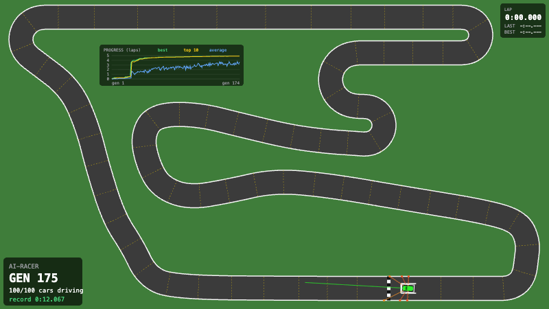
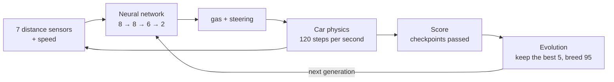
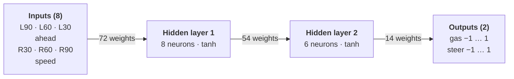
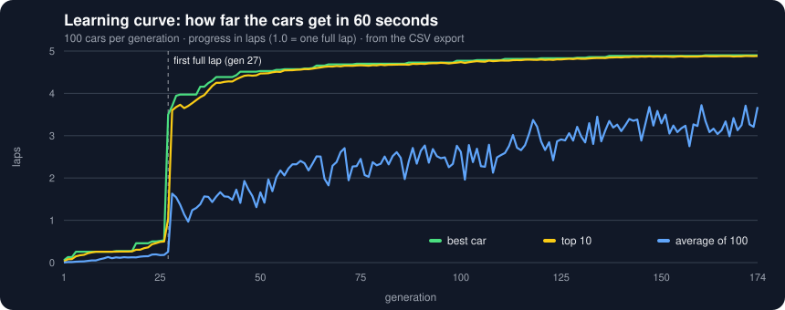
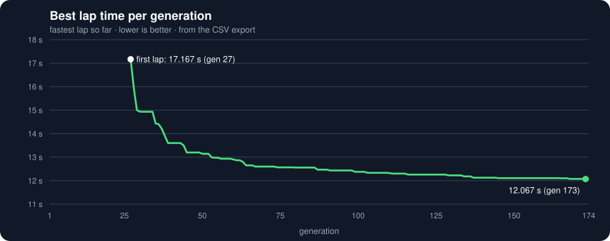
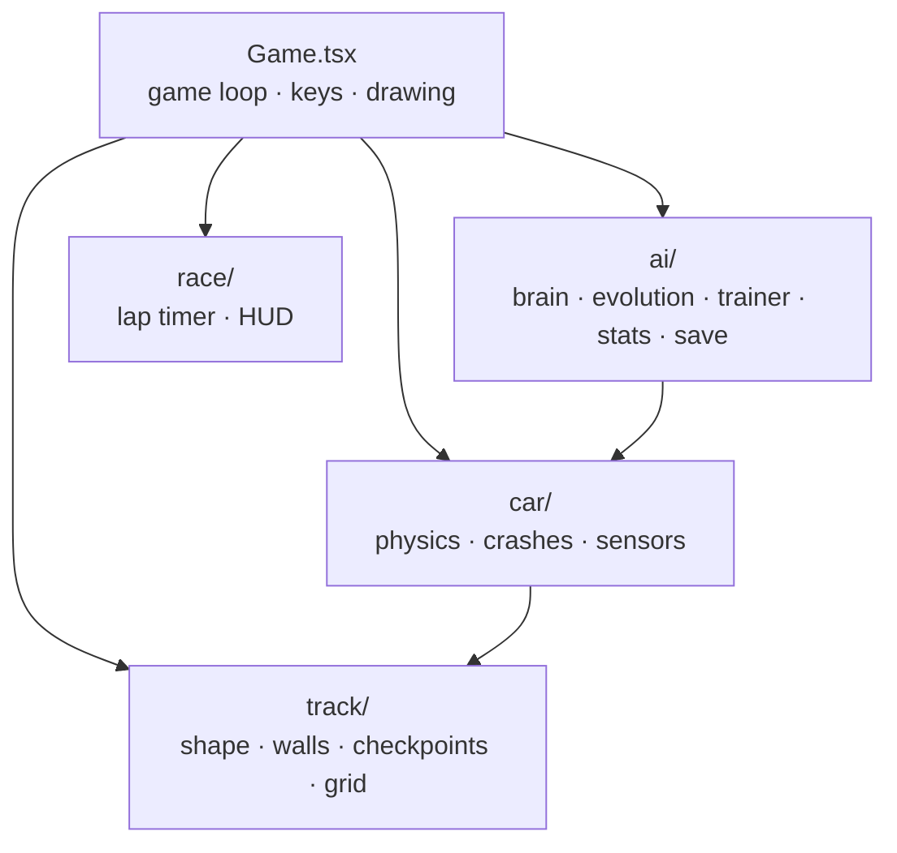

# AI-Racer

**100 cars learn to race a Formula 1 track from scratch, using a neural network and evolution, right in the browser.**

**[▶ Watch it live](https://ai-racer-eight.vercel.app)**: the trained AI starts driving right away. Press N to watch it learn from zero.

No machine learning libraries: the neural network, the genetic algorithm, the physics and the
collision detection are written from scratch in TypeScript, so every number the AI learns can be explained.



| | |
|---|---|
| **Network** | 8 inputs → 8 → 6 → 2 outputs, 140 weights, no backpropagation |
| **Learning** | neuroevolution: 100 cars per generation, the best brains are bred |
| **First full lap** | generation **27** (17.2 s) |
| **Best lap** | **12.067 s** in generation 173 (30% faster than the first lap) |
| **Cars finishing a lap** | 0 of 100 at the start → **77 of 100** by generation 174 |

---

## How it works

Every car drives with its own small neural network. It looks at the track through 7 distance
sensors, decides how much gas and steering to use, and gets a score for how far it gets.
When all cars are out, the best brains are mixed into the next generation.



### 1. The car sees the track

Seven lines go out from the car (90° left to 90° right) and measure the distance to the nearest
wall, up to 300 px. Together with the speed, that's everything the AI knows. It never sees the
track as a picture or knows where it is.

| Input | Meaning | Range |
|---|---|---|
| `L90` `L60` `L30` | distance to the wall on the left | 0 = touching … 1 = nothing in 300 px |
| `ahead` | distance straight ahead | 0 … 1 |
| `R30` `R60` `R90` | distance to the wall on the right | 0 … 1 |
| `speed` | current speed / top speed | −0.25 (reverse) … 1 |

### 2. The brain decides



A fully connected network with **140 weights** (8×9 + 6×9 + 2×7, the +1 is each neuron's bias).
`tanh` keeps every output between −1 and 1, which is exactly the range the car accepts:
`gas = 1` is full throttle, `−1` is full braking, `0.4` is a little gas.
The brain decides 30 times per second.

### 3. The best brains are bred

There is no backpropagation and no labelled data. The AI learns like natural selection:

1. **100 cars** start at the same time, each with its own random brain. Cars drive through each other.
2. A car is **out** when it hits a wall, or when it doesn't reach a new checkpoint for 5 seconds.
3. When all cars are out (or after 60 s), every car gets a **score**: the number of checkpoints it passed.
   With the same number of checkpoints, the car that **survived longer** wins (see the experiment log).
4. **The best 5 brains** go to the next generation unchanged, so the best result is never lost.
5. **The other 95** each get two parents from the best 20. Every weight comes from one parent (crossover),
   and about 10% of the weights get a small random change (mutation).

Training runs up to **~10–13× faster than real time** in the browser (key `5`).

---

## Results

One training run, 174 generations (2.5 hours of simulated racing), exported with the built-in CSV export.





| Generation | What happened |
|---|---|
| 1 | random brains: the best car gets 6% of a lap |
| 10–26 | learning the first corners and the hairpin, up to half a lap |
| **27** | **first full lap: 17.167 s** (2 cars) |
| 30 | 39 cars finish a lap, best lap under 15 s |
| 53 | best lap under 13 s |
| 100 | 55 cars finish a lap, best lap 12.375 s |
| **173** | **best lap 12.067 s** |
| 174 | 77 of 100 cars finish a lap |

The saved brains from generation **27**, **69** and **174** are in [`ai/results/`](ai/results).
Load one with the `L` key to watch that exact driver: a brain always drives the same way,
because the physics is deterministic.

---

## Experiment log: what failed and how it was fixed

Four problems blocked the project. Each one was measured, fixed, and measured again.

| # | Problem | Fix | Before | After |
|:-:|---|---|:-:|:-:|
| 1 | The AI got stuck at a hairpin | Reward surviving, not rushing | 3 of 6 runs learn a lap | **24 of 24** |
| 2 | 100 cars were too slow to train | Spatial grid for the walls | 1.2× real time | **20×+ real time** |
| 3 | The road folded into itself | Hairpins as circular arcs | Knots in the inner edge | **0 crossing walls** |
| 4 | Physics depended on the screen | Fixed 1/120 s time step | Speed changes with Hz | **Same score after reload** |

### 1. The AI got stuck at the hairpin

<sub>reward design · [the fix: commit 52c37c7](https://github.com/mkrzysztoporski/AI-Racer/commit/52c37c7)</sub>

**Problem:** the first score rewarded reaching checkpoints **fast**. All cars learned to rush up the
hill and crash into the top-left hairpin. A car that braked arrived later, scored lower, and was thrown
away before it could learn to turn. In **3 of 6 test runs**, training stayed stuck at the same
checkpoint for 150+ generations: a classic **local optimum**.

**Tried:** removing the time bonus alone helped, but one long run still got stuck for 70 generations.

**Fix:** with the same number of checkpoints, the car that **survived longer** wins, and cars with the
same score are shuffled, so no brain wins just because of its place in the list.

```diff
- return car.checkpointsPassed * 100 - car.lastProgressTime;
+ return car.checkpointsPassed + Math.min(car.time, 60) / 100;

- const ranked = [...scored].sort((a, b) => b.score - a.score);
+ const ranked = shuffle([...scored]).sort((a, b) => b.score - a.score);
```

**Result:** **24 of 24** test runs drove a full lap, after 11–43 generations.

> [!TIP]
> The score decides what the AI is able to learn. Rewarding speed too early punished exactly the
> careful drivers it needed. Speed still counts: in 60 seconds, a faster car passes more checkpoints.

### 2. 100 cars were too slow

<sub>performance · [the fix: commit 208a705](https://github.com/mkrzysztoporski/AI-Racer/commit/208a705)</sub>

**Problem:** every car checked all **2,304** wall pieces on every physics step. For 100 cars that is
over **27 million** wall checks per second of driving, so the game only ran at **1.2× real time**:
too slow to train.

**Fix:** a **spatial grid**. The track is split into 50 px squares, each square remembers which walls
touch it, and a car only checks the squares around it. The sensors use the same grid, and the brains
decide every 4th physics step (30 times per second).

```diff
- if (hitsWall(car, track.walls)) {
+ if (hitsWall(car, wallsNear(track.grid, car.position, CAR_LENGTH))) {
```

**Result:** crash checks **94× faster**, sensors **2.5× faster**, with exactly the same results in
300 of 300 compared test drives. Without graphics, training runs at **more than 20× real time**.

> [!TIP]
> Check only what is nearby: the grid turns "every car against every wall" into
> "every car against the few walls around it".

### 3. The road folded into itself

<sub>geometry · [track.ts](web/ai-racer/game/track/track.ts)</sub>

**Problem:** the road edges are made by moving the centre line 35 px sideways (half the road width).
Where a corner is tighter than that, the inner edge goes past the corner's centre, crosses itself,
and makes a small knot that would trap a car.

**Fix:** every hairpin is built as a real circular arc with a radius of 50–78 px, with extra points
where the corner meets a straight. A check during development confirmed that no wall crosses another.

```
inner edge radius = corner radius − 35 px

a 20 px corner:   20 − 35 = −15 px   →  the edge flips over itself (knot)
a hairpin arc:    52 − 35 =  17 px   →  a clean inner edge
```

> [!TIP]
> Rule found: a corner's radius must be bigger than half the road width, or the inner edge flips over.

### 4. Physics depended on the screen

<sub>game loop · [Game.tsx](web/ai-racer/game/Game.tsx)</sub>

**Problem:** moving the cars once per frame would make them faster on a 120 Hz screen than on a 60 Hz
one, and a saved brain would drive differently on another computer.

**Fix:** a **fixed time step**. The physics always moves in steps of exactly 1/120 s. Each frame runs
as many steps as the time that passed, and more of them when training is sped up.

```ts
// the game loop, simplified
leftover += frameTime * speed;
while (leftover >= STEP) { // STEP = 1 / 120 s
  updateTrainer(trainer, track, STEP);
  leftover -= STEP;
}
```

**Result:** the simulation is **deterministic**. A brain that is saved and loaded again gets **exactly
the same score** (tested: 155.60 → 155.60). Speeding training up changes how many steps run per frame,
never the physics itself.

> [!TIP]
> Repeatable physics is what makes saving, loading and comparing brains meaningful.

> [!NOTE]
> The test runs above were measured during development with a headless run of the same game code (no graphics).

---

## Design decisions

- **Neuroevolution instead of reinforcement learning.** The only feedback is "how far did you get",
  only at the end of a run. A genetic algorithm needs no gradients for that, runs 100 cars in parallel,
  and every step is easy to explain.
- **Everything from scratch.** No TensorFlow, no physics engine, only TypeScript,
  so the whole system can be read and understood.
- **Game logic separate from drawing.** Physics, sensors, the brain and evolution are never affected by the screen.
  That is what makes fast training, saving and loading, and running without graphics possible.
- **Two outputs that can be "a little".** Gas and steering are numbers from −1 to 1, not on/off keys.
  The keyboard and the network use the same controls, so the physics you test by hand is what the AI learns on.

---

## Run it yourself

```bash
cd web/ai-racer
pnpm install   # after cloning, and when dependencies change
pnpm dev
```

Open http://localhost:3000. The first visit shows the trained AI from generation 174: press **N** to train from zero, and **5** for maximum speed.
The first full laps usually appear after 20–40 generations.

### Controls

| Key | Action |
|---|---|
| ↑ / W, ↓ / S, ← → / A D | drive yourself |
| Space | new car in the start box |
| **M** | switch between driving and AI training |
| **1 – 5** | training speed: 1×, 2×, 5×, 10×, max |
| H | hide / show crashed AI cars |
| G / P | show the progress chart / save it as PNG |
| B / L | download the best brain / load a brain file |
| C | download the training history as CSV |
| N | start a new training |
| **T** | watch the trained AI from generation 174 (also shown on the first visit) |

Training is saved in the browser after every generation, so it continues after a reload.

<details>
<summary><b>Project structure</b></summary>

```
AI-Racer/
├── README.md                       # you are here
├── ai/
│   └── results/                    # saved brains (.json), training history (.csv), charts, demo GIF
└── web/
    └── ai-racer/                   # the game (Next.js 16)
        ├── app/
        │   ├── page.tsx            # home page, shows the game full window
        │   └── layout.tsx          # page title
        └── game/
            ├── Game.tsx            # game loop, keys, drawing
            ├── geometry.ts         # line crossing math (crashes, checkpoints, sensors)
            ├── ai/
            │   ├── brain.ts        # neural network: sensors in, gas and steer out
            │   ├── evolution.ts    # score + breeding the next generation
            │   ├── trainer.ts      # 100 AI cars, generations, stuck check, best lap
            │   ├── stats.ts        # numbers per generation, CSV table
            │   ├── drawChart.ts    # progress chart, P saves it as a PNG
            │   └── saveBrain.ts    # save / load the best brain, CSV export
            ├── car/
            │   ├── car.ts          # car data, physics, crashes, checkpoints
            │   ├── controls.ts     # keyboard: arrows / WASD drive, other keys go to the game
            │   ├── drawCar.ts      # draws a car in its color (white outline = watched car)
            │   ├── sensors.ts      # the AI's eyes: distances to the walls
            │   └── drawSensors.ts  # draws the sensor lines
            ├── track/
            │   ├── track.ts        # track shape, walls, checkpoints, start position
            │   ├── drawTrack.ts    # draws the track and start box
            │   └── wallGrid.ts     # walls sorted into squares, so cars only check walls nearby
            └── race/
                ├── lapTimer.ts     # lap timer: current, last and best lap
                └── drawHud.ts      # lap timer box, AI inputs panel, training box
```



</details>

<details>
<summary><b>Settings to experiment with</b></summary>

| File | Setting | Default |
|---|---|---|
| `ai/trainer.ts` | `LAYERS` (network shape) | `[8, 8, 6, 2]` |
| `ai/trainer.ts` | `POPULATION`, `STUCK_TIME`, `MAX_TIME` | 100, 5 s, 60 s |
| `ai/evolution.ts` | `ELITE_COUNT`, `PARENT_POOL` | 5, 20 |
| `ai/evolution.ts` | `MUTATION_RATE`, `MUTATION_AMOUNT` | 10%, ±0.5 |
| `car/sensors.ts` | `SENSOR_COUNT`, `SENSOR_SPREAD`, `SENSOR_RANGE` | 7, 180°, 300 px |
| `car/car.ts` | `MAX_SPEED`, `TURN_RATE`, … | fast and twitchy |

</details>

---

## What's next

- [ ] Headless experiment runner with fixed random seeds, to compare network sizes, population sizes and sensor counts over many runs
- [ ] Generalisation test: does a brain trained on one track survive a new track?
- [ ] Show the network live: which neurons fire in which corner
- [ ] A reinforcement learning baseline to compare with neuroevolution

## Built with

TypeScript · Next.js 16 · React 19 · HTML Canvas · no ML or physics libraries

Built by [Mateusz Krzysztoporski](https://github.com/mkrzysztoporski)
